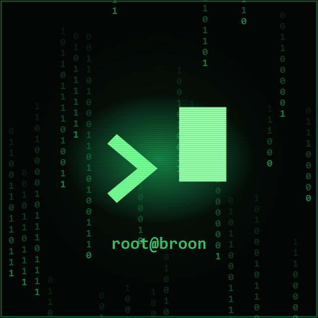

<div align="center">



</div>

```bash
root@broon:~$ whoami
> br00n — builder de automações, bots e sistemas com IA.

root@broon:~$ cat ./bio.txt
> Transformo café em código e código em dinheiro.
> Automatizo tudo que faço mais de duas vezes.
> Não tenho bugs — tenho features não documentadas.
```

### `~/stack`


### `~/projetos $ ls -la`

```text
drwxr-xr-x  bots-whatsapp/     assistentes de IA que atendem, cruzam dados e respondem sozinhos
drwxr-xr-x  automacoes-web/    geradores de site e painéis que sobem tudo com um clique
drwxr-xr-x  scrapers-bots/     quando a tarefa é repetitiva, um script faz por mim
```

```bash
root@broon:~$ sudo rm -rf /tarefas-repetitivas
root@broon:~$ _
```
