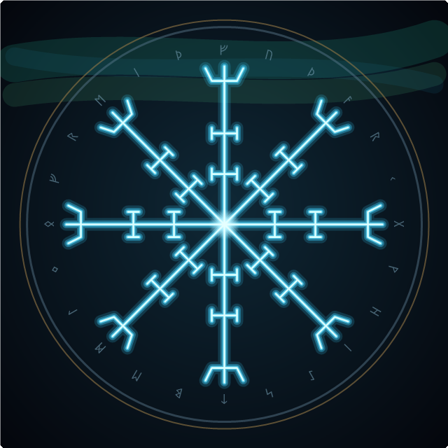

# ᚷ · GRÍMNIR · ᚷ
### *o encapuzado*

> *Dizem que ninguém nunca viu meu rosto.*
> *Também, né — fico 14 horas por dia atrás de três monitores.*

---

Builder vindo das brumas do Norte. Forjo **automações, assistentes com IA e aplicações web** —
do protótipo ao deploy, sem temer as Nornas da sexta-feira à noite.

- ⚒️ **Forjando agora:** bots de WhatsApp, assistentes comerciais com IA e uns SaaS pelo caminho
- 🐦‍⬛ **Meus corvos** (Hugin & Munin) sobrevoam a produção caçando bug antes do usuário
- ⚰️ Troquei um olho por sabedoria. O outro, por um segundo monitor.
- 📜 Meu código compila na primeira. (Mentira. Mas a lenda fica melhor assim.)

### ᚱ Runas que domino

### ⚔️ Forjas recentes

- **Assistentes de IA no WhatsApp** — atendimento comercial que entende, cruza dados e responde sozinho.
- **Geradores & automações web** — do site por nicho ao painel que inicia tudo com um clique.
- **Bots & raspadores** — quando a tarefa é repetitiva, mando um servo de código no meu lugar.

---

*"O código compila. Que os deuses tenham piedade de quem for dar manutenção."*
— provérbio viking (que eu inventei agora)

